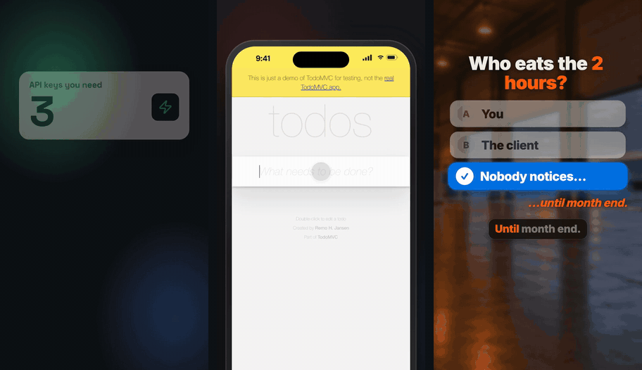
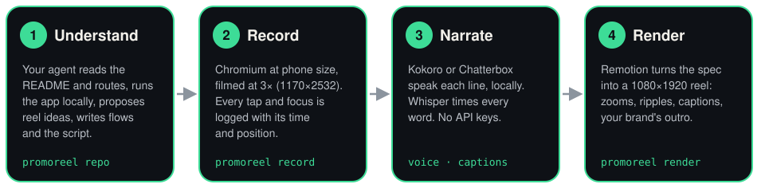

<h1 align="center">promoreel</h1>

<p align="center">
  <strong>Turn your web app into scroll-stopping 1080×1920 promo reels — with your own Claude Code or Codex. Free, local, no API keys.</strong>
</p>

<p align="center">
  <a href="LICENSE"></a>
  <a href="https://www.remotion.dev"></a>
  <a href="https://docs.anthropic.com/en/docs/claude-code"></a>
  <a href="https://github.com/openai/codex"></a>
  
</p>

<p align="center">
  
</p>

<p align="center">
  ▶ <a href="examples/promoreel-promo/out/promoreel-promo.mp4">promoreel's own promo</a> (32 s) ·
  <a href="examples/generic/out/todo-promo.mp4">TodoMVC demo</a> (33 s) ·
  <a href="examples/crewdash/out/video-01.mp4">CrewDash</a> (42 s)
</p>

---

## Why

A short vertical video is the best way to show what a web app does. Making one by hand means:
- screen-recording on a phone;
- cutting out the waiting;
- recording a voice-over;
- typing captions;
- doing it all again every time the UI changes.

promoreel does that work with tools you already have:
- **Your coding agent does the thinking.** Claude Code or Codex reads your app, proposes reel ideas, writes the flows and
  the script, then checks the frames. It runs on your existing subscription.
- **The footage is real.** A recorder films your app at phone size (3×, 1170×2532) and logs every tap. The reel zooms
  onto each tap, draws ripples and glows, and cuts out the waiting.
- **Everything else is free and local.**
  - Voice: Kokoro, or the more natural Chatterbox.
  - Captions: Whisper.
  - Rendering: Remotion.
  - No API keys, no paid services, no uploads.
- **It's reproducible.** A reel is a JSON spec, and your brand is one `brand.json`. When the UI changes, record again
  and re-render.

## How it works

<p align="center">
  
</p>

1. **Understand.** `promoreel repo` clones your GitHub repo with your own `gh` login, or uses a local folder. Your
   agent reads the README and routes, runs the app locally, and proposes 3–5 reel ideas from real flows.
2. **Record.** The agent writes flow files (go to, tap, type, scroll, mark), and `promoreel record` films each step as
   a clip. Each clip gets a JSON file listing every tap and focus, with its time and position.
3. **Narrate.** The script lives in the reel's spec. `promoreel voice` speaks each line locally, and `promoreel
   captions` times every word with Whisper. Lines are timed into the video automatically. If a line is longer than the
   footage under it, that clip slows down until it fits, and the CLI tells you.
4. **Render.** `promoreel render` produces `out/<id>.mp4`, an 8-frame contact sheet the agent reads to check its work,
   and an entry in `out/manifest.json`.

The template has six scene types:

| Scene | What it shows |
|---|---|
| `hook` | A big question, with optional odometer number cards |
| `quiz` | Options; the right one lights up |
| `phone` | Your recordings, with zooms, tap ripples, glows, badges and jump cuts |
| `terminal` | For developer tools |
| `showcase` | A finished video in a frame |
| `end` | Your feature grid and call to action |

## Quickstart (5 minutes)

You need Node 20+, ffmpeg and git. These steps were tested on macOS with Apple silicon.

```bash
brew install ffmpeg                         # Linux: apt install ffmpeg
git clone https://github.com/ravish049/promoreel.git
cd promoreel
npm install
npx playwright-core install chromium        # the recorder's browser (skip it if Playwright's Chromium is already cached)
npx promoreel doctor                        # checks everything and prints the fix for anything missing
```

Make the example reel. It records Playwright's public TodoMVC demo, voices it with Kokoro, captions it with Whisper and
renders it:

```bash
npx promoreel all examples/generic --pretty
open examples/generic/out/todo-promo.mp4      # 33 s, plus todo-promo-sheet.png
```

On an M4 Max that took about 1 minute end to end, recording included. The first run also downloads the Kokoro model
(~330 MB) and the Whisper model (~140 MB), and builds whisper.cpp.

**Optional:** for the more natural Chatterbox voice (Python 3.11, about 2 GB), run `bash scripts/install-chatterbox.sh`.

## Talk to your agent

Open the repo in your agent and ask in plain words. Claude Code picks up the
[`promoreel` skill](.claude/skills/promoreel/SKILL.md); Codex reads [`AGENTS.md`](AGENTS.md). Both follow the same
steps:
1. check the tools;
2. understand the app;
3. propose ideas and wait for your pick;
4. write the script;
5. record, voice, caption and render;
6. read the frames and fix what's off;
7. report back.

**Claude Code** (`claude` in this folder):
> Make a 35-second promo reel of my app in ../my-app. It runs on localhost:3000. Propose a few ideas first.

> Make a tutorial reel showing how to create an invoice in my app. Use the test account in my shell env.

**Codex** (`codex` in this folder):
> Read AGENTS.md, then make a promo reel of ../my-app (npm run dev, port 5173). Suggest 3 ideas before recording.

> Re-record the onboarding flow; the signup page changed. Then re-render the launch reel.

Ground rules the agent follows:
- It never writes credentials to a file. Test-account logins come from `PROMOREEL_LOGIN_EMAIL` and
  `PROMOREEL_LOGIN_PASSWORD` in your shell.
- It records local builds, not production.
- It never publishes anything unless you ask.

## Point it at your GitHub repo

```bash
gh auth login                                   # once; promoreel never sees or stores a token
npx promoreel repo your-name/your-app           # shallow clone → apps/your-app/ (git-ignored), plus an app summary
```

The summary lists:
- the README;
- the framework (Next.js, Vite, SvelteKit, Remix, Nuxt, Astro, Rails, Django, …);
- the package scripts;
- an `.env.example`, if there is one;
- the routes it found.

From there, ask your agent for ideas. When a reel is ready and **you** decide to publish it:

```bash
npx promoreel release projects/your-app --tag v1.2.0 --repo your-name/your-app --dry-run   # shows the gh command
npx promoreel release projects/your-app --tag v1.2.0 --repo your-name/your-app             # gh release upload
```

More detail: [`docs/github.md`](docs/github.md).

## The script formula

Every reel follows the same shape, in 30–45 seconds:

**question hook → the problem → the product doing it, on screen → the result → the shared close**

The rules come from listening back to real renders:
- **Open with a question** the viewer answers in their head: "Losing hours between what you pay and what you bill?"
- **One idea per line.**
- **No ellipses.** TTS pauses robotically on "…". Use `|` in a line for a breath.
- **Claim only what the footage shows.** No invented numbers.
- **85–100 words for about 35 seconds.**
- **Check the read-back.** `promoreel captions` prints what Whisper heard for each line.
  - In the promo, the voice said "our lotion" instead of "Remotion". Giving that line another `seed` fixed it.

Full guide: [`script-writing.md`](.claude/skills/promoreel/script-writing.md). Every field:
[`docs/spec.md`](docs/spec.md). Flow steps: [`docs/flows.md`](docs/flows.md).

## Showcase

| | | |
|---|---|---|
| **[CrewDash](https://crewdash.ca)**: staffing software for small agencies | ["Losing hours?"](examples/crewdash/out/video-01.mp4), 42 s | GPS clock-in, checking a client's timesheet, validating the week, invoicing. A real product reel, from the project promoreel was extracted from. Chatterbox voice, a photo backdrop, every scene feature |
| **promoreel** itself | ["Make a promo reel of your app with Claude Code, free"](examples/promoreel-promo/out/promoreel-promo.mp4), 32 s | Made by its own CLI: a hook with counter cards, a `terminal` scene, the TodoMVC reel in a `showcase` frame. Chatterbox voice |
| **TodoMVC** ([Playwright's demo](https://demo.playwright.dev/todomvc)) | ["Too much in your head?"](examples/generic/out/todo-promo.mp4), 33 s | The smoke test: add, tick, filter, clear. Kokoro voice, a gradient backdrop, jump cuts and zooms |

Each example folder has its spec, brand and README: [`examples/`](examples).

## Voices

| | Kokoro (default) | Chatterbox (optional) |
|---|---|---|
| Setup | Nothing beyond `npm install` | `bash scripts/install-chatterbox.sh` (Python 3.11, ~2 GB) |
| Runs on | Any machine, CPU | Apple GPU (MPS), CUDA, or a slow CPU |
| Sound | Clean, a little even; rendered phrase by phrase | More natural; `seed` re-takes a line |
| Licence | Apache-2.0 | MIT, with Resemble AI's inaudible **PerTh watermark**, which marks the audio as AI-generated |

Both voices are free, and they're the only ones today. Paid voices (ElevenLabs and others) will be **opt-in** behind the
`VoiceProvider` interface. A provider is one file that turns lines into WAVs; the CLI handles caching, timing and
captions. See [`docs/voice-providers.md`](docs/voice-providers.md).

## CLI

| Command | Does |
|---|---|
| `promoreel init <dir> [--name] [--url]` | Scaffold a project: `brand.json`, a reel, a flow, `public/` |
| `promoreel record <project> [flow…] [--only clip,…]` | Film flows at phone size |
| `promoreel voice <project> [--reel id]` | Speak the script, time it, and write a listening sample and `out/<id>.timeline.json` |
| `promoreel captions <project> [--reel id]` | Word timings with Whisper, plus what it heard |
| `promoreel render <project> [--reel id] [--crf n]` | `out/<id>.mp4`, a contact sheet, `out/manifest.json` |
| `promoreel all <project> [--reel id] [--fresh]` | Record (what's missing) → voice → captions → render |
| `promoreel sheet <video> [png] [--at 1,4.5,…]` | A contact sheet of any video |
| `promoreel studio <project>` | Open Remotion Studio on a reel |
| `promoreel repo <owner/repo \| path>` | Clone with your `gh` login, or summarise a local app |
| `promoreel release <project> --tag <t>` | `gh release upload` a reel, only when you run it |
| `promoreel list` · `promoreel doctor` | Projects and videos · a toolchain check |

Every command streams one JSON object per line on stdout. A web UI, a CI job or an agent can follow along:
```json
{"step":"render","status":"progress","pct":64,"msg":"frames 612/980, encoded 590","project":"generic","ts":"2026-10-27T14:06:01.000Z"}
```
`--pretty` prints human-readable lines, and is the default in a terminal. `out/manifest.json` lists every finished
video with its path, sheet, duration, size and voice.

## Roadmap

- **Studio:** a local web page with:
  - a chat box that drives your own `claude -p` or `codex exec`;
  - "Connect GitHub" through `gh`;
  - live progress from the JSON lines;
  - a gallery that plays and downloads from `manifest.json`.

  The CLI and manifest are already built for it: [`docs/studio-plan.md`](docs/studio-plan.md).
- **More templates:** landscape (16:9) and square cuts, a before/after scene, background music.
- **Paid voices, opt-in only:** ElevenLabs and others behind `VoiceProvider`. Kokoro stays the default.

## FAQ

**What does it cost?**
- Nothing beyond what you already pay for your coding agent.
- The kit is MIT. Kokoro, Chatterbox and Whisper run on your machine for free.
- Remotion is free for individuals and companies of up to 3 employees (see below).
- The agent's work counts against your own Claude Code or Codex plan.

**Which OS?**
- Built and tested on **macOS with Apple silicon**.
- Linux should work (the recorder, whisper.cpp and Chatterbox on CUDA or CPU all support it) but hasn't been tested yet.
  Reports welcome.
- Windows is untested; WSL is the likely route.

**How long does a render take?**
These are measured on an M4 Max (48 GB):
- The TodoMVC example takes about 1 minute end to end (`all --fresh`, with the voice cached):
  - recording three clips: about 30 s;
  - Whisper captions: a few seconds;
  - rendering 33 s of video: about 25 s.
- Voicing its 8 lines with Kokoro the first time took about 5 s.
- Chatterbox voiced the promo's 8 lines in about 47 s.
- Slower machines take longer, and the first run adds the model downloads.

**Is Remotion free?**
Remotion is source-available under the
[Remotion License](https://github.com/remotion-dev/remotion/blob/main/LICENSE.md), not MIT:
- free for individuals, for companies with up to 3 employees, and for non-profits;
- larger companies need a [company licence](https://www.remotion.pro/license).

Using promoreel means using Remotion, so this applies to you.

**Does anything leave my machine?**
- The recorder visits only the URLs in your flows.
- The models download once from Hugging Face.
- The agent talks to its own provider as it always does.
- No footage, script or audio is uploaded by promoreel.

## Credits

- Extracted from the video project behind [CrewDash](https://crewdash.ca).
- Ideas from [digitalsamba/claude-code-video-toolkit](https://github.com/digitalsamba/claude-code-video-toolkit) (MIT)
  and Remotion's [agent skills](https://www.remotion.dev/docs/ai). No code was copied from either.
- Built on:
  - [Remotion](https://www.remotion.dev);
  - [Kokoro](https://huggingface.co/hexgrad/Kokoro-82M) via kokoro-js;
  - [Chatterbox](https://github.com/resemble-ai/chatterbox);
  - [whisper.cpp](https://github.com/ggml-org/whisper.cpp);
  - [Playwright](https://playwright.dev);
  - [Lucide](https://lucide.dev) icons.

Details and licences: [CREDITS.md](CREDITS.md).

## License

[MIT](LICENSE) © Ravish Chadha, for this repo's code. Other licences that apply:
- Remotion: the Remotion License (above).
- Kokoro: Apache-2.0.
- Chatterbox: MIT, with a watermark.
- Whisper: MIT.
- Fonts: SIL OFL 1.1.
- Lucide: ISC.

The CrewDash name, mark, footage and photo in `examples/crewdash` belong to their owner and are not covered by the MIT
licence. Contributions are welcome: see [CONTRIBUTING.md](CONTRIBUTING.md) and the
[Code of Conduct](CODE_OF_CONDUCT.md).
